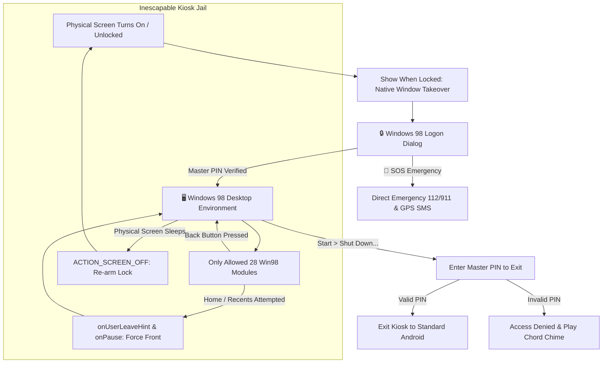

# 💾 IdiotPhone 98

> **The Authentic Windows 98 Dumbphone Launcher & Kiosk for Android**  
> *Transform your smartphone into a distraction-free, retro computing dumbphone.*

[](https://android.com)
[](https://github.com/cerogamedev/IdiotPhone)
[](#-iron-kiosk-phone-takeover)
[](LICENSE)

```text
 __________________________________________________________________
| [=] IdiotPhone 98 Setup Wizard                               [-][x]|
|==================================================================|
|  ____  _             _   ____  _                      ___   ___  |
| |_  _|/ \   o  ___ _| |_|  _ \| |__   ___  _ __   ___/ _ \ ( _ ) |
|   | |/ _ \  | / _ \_   _| |_) | '_ \ / _ \| '_ \ / _ \ (_) |/ _ \ |
|   | / ___ \ | \(_) || |_|  __/| | | | (_) | | | |  __/\__, | (_) ||
|  |__/_/   \_|_|\___/ \__|_|   |_| |_|\___/|_| |_|\___|  /_/  \___/ |
|                                                                  |
|  Minimalist Dumbphone Computing Environment for Modern Life      |
|__________________________________________________________________|
```

---

## 🎯 What is IdiotPhone 98?

**IdiotPhone 98** is a dedicated Android home launcher designed to eliminate smartphone addiction and doomscrolling. It strictly restricts your phone to essential communication tools (Phone, SMS, Contacts, WhatsApp, Gmail, Maps) and endless retro mini-games, wrapped inside a pixel-perfect **Windows 98 desktop environment** with immersive fullscreen kiosk mode.

To exit the launcher and access standard Android apps or settings, the user **must enter a Master PIN**.

---

## 📦 Download Ready APK

Pre-compiled, release-signed with both V1 (JAR) and V2 (Full APK) schemes, and ready for instant installation on Android (optimized for **Redmi / Xiaomi / HyperOS / MIUI**):

* 🚀 **[Download IdiotPhone.apk (Direct APK Download v1.3.0)](https://github.com/cerogamedev/IdiotPhone/releases/download/v1.3.0/IdiotPhone.apk)**
* 🏷️ **[GitHub Releases Page (v1.3.0 Latest)](https://github.com/cerogamedev/IdiotPhone/releases/latest)**
* 📁 **[Repository File Link (v1.3.0)](./IdiotPhone-v1.3.0.apk)**

> 💡 **Important for Xiaomi / Redmi:** If you previously installed an older test build, please **uninstall the old version first** (`Settings > Apps > Manage Apps > IdiotPhone > Uninstall`) before installing this release build to prevent signature conflict errors.

---

## 🆕 What's New in v1.3.0?

1. **🔒 Complete Phone Takeover & Iron Lock Screen**:
   - **Show When Locked & Turn Screen On**: Native Android window flags (`showWhenLocked="true"`, `turnScreenOn="true"`, `FLAG_DISMISS_KEYGUARD`) ensure that when you press the power button and turn the screen back on, IdiotPhone takes over immediately.
   - **Aggressive Kiosk Recapture**: Whenever the display turns on (`ACTION_SCREEN_ON`) or the keyguard is dismissed (`ACTION_USER_PRESENT`), IdiotPhone re-summons itself to the front.
   - **Inescapable Navigation**: Swiping home, pressing Overview/Recents, or gesture navigation immediately bounces back to IdiotPhone unless the user enters their Master PIN via the Shut Down menu.
   - **Screen Pinning (Lock Task)**: OS-level task pinning locks the notification drawer, navigation buttons, and recent apps.
2. **💬 WhatsApp 98 Messenger Overhaul**:
   - **Full Conversations & Threads List**: Replaced the simple compose form with a true retro MSN Messenger / WhatsApp client.
   - **Contact Chat Threads**: Every contact in your address book automatically has an active chat thread with message history.
   - **Incoming Message Listener**: Integrated `NotificationListenerService` that intercepts WhatsApp notifications in real time and renders them directly into your Windows 98 chat bubbles!
   - **Retro Speech Bubbles**: Left-aligned incoming ivory bubbles and right-aligned light green outbound bubbles with double checkmarks (`✓✓`) and timestamps.
   - **Quick Responses Bar**: Instant dumbphone canned replies (*"Tamam / OK"*, *"Yoldayım"*, *"Arayacağım"*, *"Neredesin?"*, etc.).
3. **📖 Address Book (Contacts) Permission & Sync Fix**:
   - Added explicit permission check and a one-click *"Grant Contacts Access"* dialog if permissions were not initially granted.
   - Fixed query column indexing and normalized number deduplication.
   - Added a live **Refresh (↻)** button on the Address Book toolbar.
4. **🎮 3 New Endlessly Replayable Retro Games (Total 28 Modules!)**:
   - **Solitaire 98 (Klondike)**: Classic Windows 98 Klondike Solitaire on emerald green felt board with drag/tap card movement, auto-move to foundations, score, timer, and victory card bounce!
   - **Snake 98 (Nokia 3310 Classic)**: Authentic monochrome LCD Nokia snake with on-screen retro D-Pad, swipe gestures, high score persistence, and infinite instant replay loop.
   - **Brick Breaker 98 (DX-Ball / Arkanoid)**: Retro arcade brick breaker with paddle physics, procedural multi-row brick generation, endless stages (Stage 1, 2, 3...), and live score.

---

## 🧰 The 28 Built-In Modules & Applications

### 📞 Core Communication & Messaging
1. **Phone Dialer 98 (`win-phone`)**: Authentic dialing keypad, call history log, and **Speed Dial 1–9** (press & hold number keys 1–9 to auto-call favorite contacts).
2. **Address Book (`win-contacts`)**: Full contacts manager with normalized digit search, direct Call, SMS, WhatsApp, and **Pin to Desktop** buttons.
3. **SMS Express (`win-sms`)**: Grouped message threads, incoming/outgoing retro speech bubbles, timestamp history, and one-tap compose modal.
4. **WhatsApp 98 Messenger (`win-whatsapp`)**: Full retro messenger with active chat threads, real-time incoming notification sync, chat bubbles, quick replies, and WhatsApp Web linking.
5. **Outlook Express (`win-gmail`)**: Nostalgic webmail viewer and desktop mail compose dialog.
6. **Microsoft Maps 98 (`win-maps`)**: OpenStreetMap Leaflet integration powered by native Android hardware GPS location.

### 🎮 Endless Retro Games
7. **Solitaire 98 (`win-solitaire`)**: Classic Klondike playing card solitaire on green felt with foundations, tableau piles, score, and infinite deal loop.
8. **Snake 98 (`win-snake`)**: Nokia 3310 green LCD dot-matrix snake with D-pad, swipe controls, speeds, high scores, and infinite replay.
9. **Brick Breaker 98 (`win-brickbreaker`)**: DX-Ball / Arkanoid retro arcade game with paddle reflection angles, brick destruction, and endless procedural stages.
10. **Minesweeper 98 (`win-minesweeper`)**: Classic Windows 98 minesweeper with smiley face indicator, flag placements, and timer.

### 🛠️ Hardware & Dumbphone Utilities
11. **Torch 98 (`win-torch`)**: Hardware LED flashlight control with glowing bulb pixel art, **Morse Code SOS Strobe** (`... --- ...`), and Screen Torch fallback.
12. **Emergency SOS & ICE Dialing (`win-emergency`)**: One-tap dialing for `112` (EU/TR) and `911` (US), plus **GPS Location Broadcast via SMS** to designated ICE contacts. Accessible directly from the Lock Screen without a PIN.
13. **Clock, Alarm & Timer (`win-alarm`)**: Multi-alarm scheduler with recurring alarms, snooze (5 min), and Dumbphone Nap Timers (15, 30, 45, 60 minutes).
14. **Focus Mode & Standby (`win-focus`)**: Distraction-free Pomodoro (25m), 1-hour Deep Work, and 2-hour Dumbphone sessions. Mutes ringers, displays a retro hourglass, and logs focused hours.
15. **Volume Mixer 98 (`win-volume`)**: System tray volume popup with Normal (🔊), Vibrate Only (📳), and Silent (🔇) sound profiles synced with Android's `AudioManager`.
16. **Disk Cleanup 98 (`win-cleanmgr`)**: Windows 98 `cleanmgr.exe` storage cleaner. Scans cache, saved notes, voice memos, and displays live internal storage space.
17. **Desktop Shortcuts & Contact Pins (`app-shortcuts`)**: Pin favorite contacts or fast actions directly onto the Windows 98 desktop grid as retro desktop icons.
18. **DirectX Diagnostic Tool (`win-dxdiag`)**: Authentic `dxdiag 98` tabs (System, Display, Sound, Network) displaying real-time hardware telemetry, CPU ABI, RAM usage, and carrier status.
19. **Registry Backup Wizard (`win-backup`)**: Export and restore all IdiotPhone data, speed dials, alarms, and notes to/from encrypted JSON.

### 🎵 Multimedia, Productivity & Organization
20. **Windows Media Player 98 (`win-mediaplayer`)**: Real-time oscilloscope audio visualizer, built-in offline Web Audio ambient tracks (Lofi Rain & Thunder, Zen 432Hz Drone, 8-Bit Chiptune), and local MP3/WAV playback.
21. **Unit & Currency Converter 98 (`win-converter`)**: Rapid offline converter for length, weight/mass, temperature, data storage, and currencies (USD, EUR, GBP, TRY, JPY).
22. **Desktop Sticky Notes 98 (`win-stickynote`)**: Colored retro post-it notes with live desktop wallpaper pin widget and autosave.
23. **Habits & Routine 98 (`win-habits`)**: Digital minimalism routine checklist with progress bars, daily streak tracking, and automated midnight reset.
24. **Universal Find & Search 98 (`win-search`)**: Windows 98 Find dialog searching across apps, address book contacts, and saved notes with instant opening.
25. **Calculator 98 (`win-calc`)**: Classic standard arithmetic calculator with memory keys (`MC`, `MR`, `MS`, `M+`) and inset 3D display.
26. **Notepad 98 (`win-notepad`)**: Clean text editor with real-time autosave, File menu, word/char counters, and time/date stamps.
27. **Sound Recorder 98 (`win-recorder`)**: Voice memo recorder featuring an active green phosphor **CRT audio oscilloscope**, playback controls, and local memo storage.
28. **Control Panel & Display (`win-controlpanel`)**: 6 retro themes, wallpaper selector, screensaver timeout, Master PIN management, and default launcher controls.

---

## 🔒 Iron Kiosk Phone Takeover



- **Immersive Sticky Fullscreen**: Android navigation bar and status bar are completely hidden.
- **Home / Recents Jail**: Pressing Home returns strictly to the IdiotPhone desktop. Attempting to switch apps via gesture or recent button forces the activity right back to the front.
- **Screen-Off State Detection**: Locks occur only when the physical display is turned off (`Intent.ACTION_SCREEN_OFF`), avoiding false lockouts during outgoing calls.
- **PIN Exit Guard**: Exiting to standard Android launchers requires entering the user's Master PIN.

---

## 🛡️ Google Play Protect & "App Not Installed" Troubleshooting

Because **IdiotPhone 98** is an open-source sideloaded launcher containing system-level Phone, SMS, and Location integrations, **Google Play Protect** may show a warning dialog upon installation (*"Blocked by Play Protect"* / *"Zararlı olabilecek uygulama engellendi"*).

If you simply tap **"OK" ("Tamam")**, Android cancels the installation and displays *"App not installed"* (*"Uygulama yüklenemedi"*).

### ✅ How to bypass Play Protect:

#### Option 1: One-Tap Bypass on Install Screen (Recommended)
1. When the Play Protect warning window appears, **DO NOT TAP "OK" / "TAMAM"**.
2. Tap the small text: **"More details"** (in Turkish: **"Daha fazla ayrıntı"** or **"Ayrıntılar ⌄"**).
3. Tap **"Install anyway (unsafe)"** (in Turkish: **"Yine de yükle (güvenli değil)"**).
4. The application will immediately install successfully.

#### Option 2: Temporarily Disable Play Protect Scanning
If your device does not show the "Install anyway" option:
1. Open the **Google Play Store** app.
2. Tap your **Profile Icon** in the top right corner > select **Play Protect**.
3. Tap the **Settings gear icon (⚙️)** in the top right.
4. Toggle OFF **"Scan apps with Play Protect"** (*"Uygulamaları Play Protect ile tara"*).
5. Install `IdiotPhone.apk` (it will install immediately without any block).
6. Once installed, you can re-enable Play Protect scanning.

#### Option 3: Signature Conflict Fix
If you previously installed an older test build:
- Go to **Settings > Apps > Manage Apps > IdiotPhone > Uninstall** first.
- Then install the new `v1.3.0` release APK to prevent `INSTALL_FAILED_UPDATE_INCOMPATIBLE` signature conflicts.

---

## 🔨 Building From Source

### Prerequisites
- JDK 11 or higher
- Android SDK (API 34)

```bash
# Clone the repository
git clone https://github.com/cerogamedev/IdiotPhone.git
cd IdiotPhone

# Build Release Signed APK
./gradlew assembleRelease

# Output APK location:
# app/build/outputs/apk/release/app-release.apk
```

---

## 📄 License

Distributed under the **MIT License**. Created by [Ceren Gör](https://github.com/cerogamedev).  
Inspired by Windows 98 design language and the digital minimalism movement.
