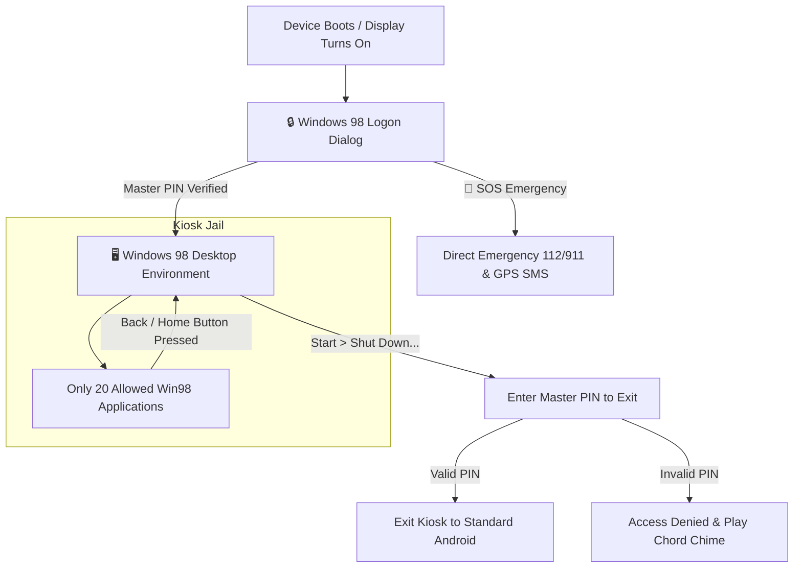

# 💾 IdiotPhone 98

> **The Authentic Windows 98 Dumbphone Launcher & Kiosk for Android**  
> *Transform your smartphone into a distraction-free, retro computing dumbphone.*

[](https://android.com)
[](https://github.com/cerogamedev/IdiotPhone)
[](#-security--kiosk-model)
[](LICENSE)

```text
 __________________________________________________________________
| [=] IdiotPhone 98 Setup Wizard                               [-][x]|
|==================================================================|
|  ____  _             _   ____  _                      ___   ___  |
| |_  _|/ \   o  ___ _| |_|  _ \| |__   ___  _ __   ___/ _ \ ( _ ) |
|   | |/ _ \  | / _ \_   _| |_) | '_ \ / _ \| '_ \ / _ \ (_) |/ _ \ |
|   | / ___ \ | \(_) || |_|  __/| | | | (_) | | | |  __/\__, | (_) ||
|  |__/_/   \_|_|\___/ \__|_|   |_| |_|\___/|_| |_|\___|  /_/  \___/ |
|                                                                  |
|  Minimalist Dumbphone Computing Environment for Modern Life      |
|__________________________________________________________________|
```

---

## 🎯 What is IdiotPhone 98?

**IdiotPhone 98** is a full-fledged Android home launcher designed to eliminate smartphone addiction and doomscrolling. It strictly restricts your phone to essential communication tools (Phone, SMS, Contacts, WhatsApp, Gmail, Maps) and retro utilities, wrapped inside a pixel-perfect **Windows 98 desktop environment**.

To exit the launcher and access standard Android apps or settings, the user **must enter a Master PIN**.

---

## 📦 Download Ready APK

Pre-compiled, release-signed with both V1 (JAR) and V2 (Full APK) schemes, and ready for instant installation on Android (optimized for **Redmi / Xiaomi / HyperOS / MIUI**):

👉 **[Download IdiotPhone.apk (2.9 MB)](./IdiotPhone.apk)**

> 💡 **Important for Xiaomi / Redmi:** If you previously installed an older test build, please **uninstall the old version first** (`Settings > Apps > IdiotPhone > Uninstall`) before installing this release build to prevent signature conflict errors.

---

## 🧰 The 20 Built-In Modules & Applications

IdiotPhone 98 contains 20 fully working applications and retro utilities:

### 📞 Core Communication
1. **Phone Dialer 98 (`win-phone`)**: Authentic dialing keypad, call history log, and **Speed Dial 1–9** (press & hold number keys 1–9 to auto-call favorite contacts).
2. **Address Book (`win-contacts`)**: Full contacts manager with normalized digit search and direct Call, SMS, WhatsApp, and **Pin to Desktop** buttons.
3. **SMS Express (`win-sms`)**: Grouped message threads, incoming/outgoing retro speech bubbles, timestamp history, and one-tap compose modal.
4. **WhatsApp 98 (`win-whatsapp`)**: Clean dumbphone messaging bridge featuring **8 Quick Dumbphone Templates** (*"On my way"*, *"Call you later"*, etc.), contact auto-selection, and embedded in-app WhatsApp Web.
5. **Outlook Express (`win-gmail`)**: Nostalgic webmail viewer and desktop mail compose dialog.
6. **Microsoft Maps 98 (`win-maps`)**: OpenStreetMap Leaflet integration powered by native Android hardware GPS location (`AndroidBridge.getCurrentLocationJson`).

### 🛠️ Hardware & Dumbphone Utilities
7. **Torch 98 (`win-torch`)**: Hardware LED flashlight control with glowing bulb pixel art, **Morse Code SOS Strobe** (`... --- ...`), and Screen Torch fallback.
8. **Emergency SOS & ICE Dialing (`win-emergency`)**: One-tap dialing for `112` (EU/TR) and `911` (US), plus **GPS Location Broadcast via SMS** to designated ICE (In Case of Emergency) contacts. Accessible directly from the Lock Screen without a PIN.
9. **Clock, Alarm & Timer (`win-alarm`)**: Multi-alarm scheduler with recurring alarms, snooze (5 min), and Dumbphone Nap Timers (15, 30, 45, 60 minutes).
10. **Focus Mode & Standby (`win-focus`)**: Distraction-free Pomodoro (25m), 1-hour Deep Work, and 2-hour Dumbphone sessions. Mutes ringers, displays a retro hourglass, and logs focused hours.
11. **Volume Mixer 98 (`win-volume`)**: System tray volume popup with Normal (🔊), Vibrate Only (📳), and Silent (🔇) sound profiles synced with Android's `AudioManager`.
12. **Disk Cleanup 98 (`win-cleanmgr`)**: Windows 98 `cleanmgr.exe` storage cleaner. Scans cache, saved notes, voice memos, and displays live internal storage space.
13. **Desktop Shortcuts & Contact Pins (`app-shortcuts`)**: Pin favorite contacts or fast actions directly onto the Windows 98 desktop grid as retro desktop icons.
14. **DirectX Diagnostic Tool (`win-dxdiag`)**: Authentic `dxdiag 98` tabs (System, Display, Sound, Network) displaying real-time hardware telemetry, CPU ABI, RAM usage, and carrier status.
15. **Registry Backup Wizard (`win-backup`)**: Export and restore all IdiotPhone data, speed dials, alarms, and notes to/from encrypted JSON.

### 🎮 Nostalgic Retro Utilities
16. **Calculator 98 (`win-calc`)**: Classic standard arithmetic calculator with memory keys (`MC`, `MR`, `MS`, `M+`) and inset 3D display.
17. **Notepad 98 (`win-notepad`)**: Clean text editor with real-time autosave, File menu, word/char counters, and time/date stamps.
18. **Sound Recorder 98 (`win-recorder`)**: Voice memo recorder featuring an active green phosphor **CRT audio oscilloscope**, playback controls, and local memo storage.
19. **Starfield Screensaver (`app-screensaver`)**: Authentic Windows 98 3D flying Starfield screensaver on HTML5 Canvas. Dims the display after inactivity for AMOLED battery savings.
20. **Control Panel (`win-controlpanel`)**: 6 retro themes (Win98 Classic Teal, AMOLED Solid Black, Matrix Green, Midnight Navy, Sepia 95, Cherry CRT), CRT phosphor scanline shader toggle, screensaver timeout, and Master PIN management.

---

## 🔒 Security & Kiosk Model



- **Home Button / Back Button Override**: The Android Back button is bound to window management. Pressing Home returns strictly to the IdiotPhone desktop.
- **Screen-Off State Detection**: IdiotPhone uses `Intent.ACTION_SCREEN_OFF` broadcasts. Normal app switches or returning from incoming phone calls do **not** trigger false lockouts; locking occurs only when the physical display is turned off.
- **PIN Exit Guard**: Exiting to standard Android launchers requires entering the user's Master PIN.

---

## 📲 Installation Guide (Redmi / Xiaomi / HyperOS / MIUI)

1. **Install APK**:
   - Download [`IdiotPhone-v1.0.0.apk`](./IdiotPhone-v1.0.0.apk) and install it on your device.
   - Allow *"Install from unknown sources"* if prompted.
2. **First Boot (Master PIN Setup)**:
   - Launch **IdiotPhone**.
   - The **Security Setup Wizard** will appear. Enter a 4–8 digit Master PIN (e.g., `1234`).
   - Grant phone, SMS, contacts, and location permissions.
3. **Set as Default Launcher**:
   - Open **Settings > Apps > Manage Apps > Three Dots (top right) > Default Apps > Launcher (Home Screen)**.
   - Select **IdiotPhone**.
4. **Exiting Kiosk Mode**:
   - Go to **Start > Shut Down... > Shut down & Exit to Android**.
   - Enter your Master PIN to return to standard Android.

---

## 🔨 Building From Source

### Prerequisites
- JDK 11 or higher
- Android SDK (API 34)

```bash
# Clone the repository
git clone https://github.com/cerogamedev/IdiotPhone.git
cd IdiotPhone

# Build Debug APK
./gradlew assembleDebug

# Output APK location:
# app/build/outputs/apk/debug/app-debug.apk
```

---

## 📄 License

Distributed under the **MIT License**. Created by [Ceren Gör](https://github.com/cerogamedev).
Inspired by Windows 98 design language and the digital minimalism movement.
