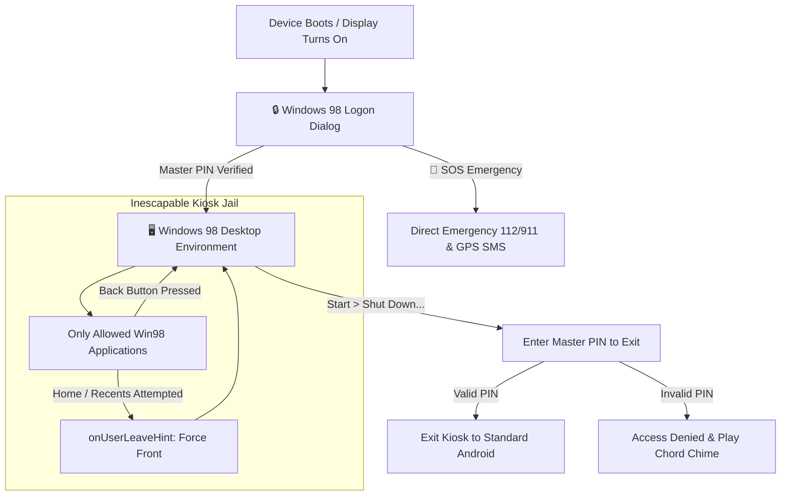

# 💾 IdiotPhone 98

> **The Authentic Windows 98 Dumbphone Launcher & Kiosk for Android**  
> *Transform your smartphone into a distraction-free, retro computing dumbphone.*

[](https://android.com)
[](https://github.com/cerogamedev/IdiotPhone)
[](#-true-inescapable-kiosk-launcher)
[](LICENSE)

```text
 __________________________________________________________________
| [=] IdiotPhone 98 Setup Wizard                               [-][x]|
|==================================================================|
|  ____  _             _   ____  _                      ___   ___  |
| |_  _|/ \   o  ___ _| |_|  _ \| |__   ___  _ __   ___/ _ \ ( _ ) |
|   | |/ _ \  | / _ \_   _| |_) | '_ \ / _ \| '_ \ / _ \ (_) |/ _ \ |
|   | / ___ \ | \(_) || |_|  __/| | | | (_) | | | |  __/\__, | (_) ||
|  |__/_/   \_|_|\___/ \__|_|   |_| |_|\___/|_| |_|\___|  /_/  \___/ |
|                                                                  |
|  Minimalist Dumbphone Computing Environment for Modern Life      |
|__________________________________________________________________|
```

---

## 🎯 What is IdiotPhone 98?

**IdiotPhone 98** is a dedicated Android home launcher designed to eliminate smartphone addiction and doomscrolling. It strictly restricts your phone to essential communication tools (Phone, SMS, Contacts, WhatsApp, Gmail, Maps) and retro utilities, wrapped inside a pixel-perfect **Windows 98 desktop environment** with immersive fullscreen kiosk mode.

To exit the launcher and access standard Android apps or settings, the user **must enter a Master PIN**.

---

## 📦 Download Ready APK

Pre-compiled, release-signed with both V1 (JAR) and V2 (Full APK) schemes, and ready for instant installation on Android (optimized for **Redmi / Xiaomi / HyperOS / MIUI**):

* 🚀 **[Download IdiotPhone.apk (Direct APK Download v1.2.0)](https://github.com/cerogamedev/IdiotPhone/releases/download/v1.2.0/IdiotPhone.apk)**
* 🏷️ **[GitHub Releases Page (v1.2.0 Latest)](https://github.com/cerogamedev/IdiotPhone/releases/latest)**
* 📁 **[Repository File Link (v1.2.0)](./IdiotPhone-v1.2.0.apk)**

> 💡 **Important for Xiaomi / Redmi:** If you previously installed an older test build, please **uninstall the old version first** (`Settings > Apps > Manage Apps > IdiotPhone > Uninstall`) before installing this release build to prevent signature conflict errors.

---

## 🆕 What's New in v1.2.0?

1. **Touch / Tap Interaction Fixed**:
   - Fixed an issue where touching desktop icons was blocked by an overlapping transparent DOM shortcut container.
   - Re-architected desktop touch hit-areas: sub-elements (`img`, `span`) ignore touch interception, ensuring clean instant taps directly to the parent icon.
2. **Portrait / Vertical Orientation Awareness**:
   - Locked native orientation strictly to **portrait** (`android:screenOrientation="portrait"`).
   - Desktop icon grid restructured as a clean, thumb-friendly **3-column vertical grid** with smooth touch scrolling (`overflow-y: auto`).
   - Windows automatically fit the entire vertical smartphone viewport (`100vw` width, adaptive height) leaving only the classic Win98 taskbar at the bottom.
3. **True Inescapable Kiosk Mode**:
   - **Immersive Sticky Fullscreen**: Android status bar and navigation bar are hidden via `SYSTEM_UI_FLAG_IMMERSIVE_STICKY`.
   - **Recapture on Home / Recents**: Attempts to leave the launcher via Home button or app switcher trigger `onUserLeaveHint()`, immediately re-focusing IdiotPhone unless Master PIN is entered.
   - **Inescapable Back Button**: Hardware Back button closes windows/menus but never exits the desktop launcher.
   - **One-Tap Default Launcher Setting**: Added a direct shortcut in Control Panel & Shut Down menu to set IdiotPhone as your permanent Android default home screen.
   - **Android Screen Pinning (Lock Task)**: Native OS-level kiosk lock pinning support.
4. **5 New Retro Dumbphone Modules (Total of 25 Utilities!)**:
   - **Windows Media Player 98**: Offline ambient synth generators (Lofi Rain & Thunder, Zen 432Hz Focus Drone, 8-Bit Chiptune) with a green CRT oscilloscope visualizer and local audio player.
   - **Unit & Currency Converter 98**: Offline multi-category conversion (Length, Weight, Temperature, Data, Currency).
   - **Desktop Sticky Notes 98**: Retro post-it notes with live desktop wallpaper pin widget and autosave.
   - **Habits & Routine 98**: Daily dumbphone routine checklists, progress meters, streaks, and midnight auto-reset.
   - **Universal Find & Search 98**: Win98 Find dialog searching across apps, contacts, and notes with one-tap launching.

---

## 🧰 The 25 Built-In Modules & Applications

### 📞 Core Communication
1. **Phone Dialer 98 (`win-phone`)**: Authentic dialing keypad, call history log, and **Speed Dial 1–9** (press & hold number keys 1–9 to auto-call favorite contacts).
2. **Address Book (`win-contacts`)**: Full contacts manager with normalized digit search and direct Call, SMS, WhatsApp, and **Pin to Desktop** buttons.
3. **SMS Express (`win-sms`)**: Grouped message threads, incoming/outgoing retro speech bubbles, timestamp history, and one-tap compose modal.
4. **WhatsApp 98 (`win-whatsapp`)**: Clean dumbphone messaging bridge featuring **8 Quick Dumbphone Templates** (*"On my way"*, *"Call you later"*, etc.), contact auto-selection, and embedded in-app WhatsApp Web.
5. **Outlook Express (`win-gmail`)**: Nostalgic webmail viewer and desktop mail compose dialog.
6. **Microsoft Maps 98 (`win-maps`)**: OpenStreetMap Leaflet integration powered by native Android hardware GPS location.

### 🛠️ Hardware & Dumbphone Utilities
7. **Torch 98 (`win-torch`)**: Hardware LED flashlight control with glowing bulb pixel art, **Morse Code SOS Strobe** (`... --- ...`), and Screen Torch fallback.
8. **Emergency SOS & ICE Dialing (`win-emergency`)**: One-tap dialing for `112` (EU/TR) and `911` (US), plus **GPS Location Broadcast via SMS** to designated ICE contacts. Accessible directly from the Lock Screen without a PIN.
9. **Clock, Alarm & Timer (`win-alarm`)**: Multi-alarm scheduler with recurring alarms, snooze (5 min), and Dumbphone Nap Timers (15, 30, 45, 60 minutes).
10. **Focus Mode & Standby (`win-focus`)**: Distraction-free Pomodoro (25m), 1-hour Deep Work, and 2-hour Dumbphone sessions. Mutes ringers, displays a retro hourglass, and logs focused hours.
11. **Volume Mixer 98 (`win-volume`)**: System tray volume popup with Normal (🔊), Vibrate Only (📳), and Silent (🔇) sound profiles synced with Android's `AudioManager`.
12. **Disk Cleanup 98 (`win-cleanmgr`)**: Windows 98 `cleanmgr.exe` storage cleaner. Scans cache, saved notes, voice memos, and displays live internal storage space.
13. **Desktop Shortcuts & Contact Pins (`app-shortcuts`)**: Pin favorite contacts or fast actions directly onto the Windows 98 desktop grid as retro desktop icons.
14. **DirectX Diagnostic Tool (`win-dxdiag`)**: Authentic `dxdiag 98` tabs (System, Display, Sound, Network) displaying real-time hardware telemetry, CPU ABI, RAM usage, and carrier status.
15. **Registry Backup Wizard (`win-backup`)**: Export and restore all IdiotPhone data, speed dials, alarms, and notes to/from encrypted JSON.

### 🎵 New Multimedia, Productivity & Organization (v1.2.0)
16. **Windows Media Player 98 (`win-mediaplayer`)**: Real-time oscilloscope audio visualizer, built-in offline Web Audio ambient tracks (Lofi Rain & Thunder, Zen 432Hz Drone, 8-Bit Chiptune), and local MP3/WAV playback.
17. **Unit & Currency Converter 98 (`win-converter`)**: Rapid offline converter for length, weight/mass, temperature, data storage, and currencies (USD, EUR, GBP, TRY, JPY).
18. **Desktop Sticky Notes 98 (`win-stickynote`)**: Colored retro post-it notes with live desktop wallpaper pin widget and autosave.
19. **Habits & Routine 98 (`win-habits`)**: Digital minimalism routine checklist with progress bars, daily streak tracking, and automated midnight reset.
20. **Universal Find & Search 98 (`win-search`)**: Windows 98 Find dialog searching across apps, address book contacts, and saved notes with instant opening.

### 🎮 Nostalgic Retro Utilities
21. **Calculator 98 (`win-calc`)**: Classic standard arithmetic calculator with memory keys (`MC`, `MR`, `MS`, `M+`) and inset 3D display.
22. **Notepad 98 (`win-notepad`)**: Clean text editor with real-time autosave, File menu, word/char counters, and time/date stamps.
23. **Sound Recorder 98 (`win-recorder`)**: Voice memo recorder featuring an active green phosphor **CRT audio oscilloscope**, playback controls, and local memo storage.
24. **Starfield Screensaver (`app-screensaver`)**: Authentic Windows 98 3D flying Starfield screensaver on HTML5 Canvas. Dims the display after inactivity for AMOLED battery savings.
25. **Control Panel (`win-controlpanel`)**: 6 retro themes, wallpaper selector, screensaver timeout, Master PIN management, and default launcher controls.

---

## 🔒 True Inescapable Kiosk Launcher



- **Immersive Sticky Fullscreen**: Android navigation bar and status bar are completely hidden.
- **Home / Recents Jail**: Pressing Home returns strictly to the IdiotPhone desktop. Attempting to switch apps via gesture or recent button forces the activity right back to the front.
- **Screen-Off State Detection**: Locks occur only when the physical display is turned off (`Intent.ACTION_SCREEN_OFF`), avoiding false lockouts during outgoing calls.
- **PIN Exit Guard**: Exiting to standard Android launchers requires entering the user's Master PIN.

---

## 📲 Installation Guide (Redmi / Xiaomi / HyperOS / MIUI)

1. **Install APK**:
   - Download [`IdiotPhone.apk`](./IdiotPhone.apk) and install it on your device.
   - Allow *"Install from unknown sources"* if prompted.
2. **First Boot (Master PIN Setup)**:
   - Launch **IdiotPhone**.
   - The **Security Setup Wizard** will appear. Enter a 4–8 digit Master PIN (e.g., `1234`).
   - Grant phone, SMS, contacts, and location permissions.
3. **Set as Default Launcher**:
   - Open **Control Panel > Set as Default Home Launcher** (or go to **Settings > Apps > Manage Apps > Default Apps > Launcher**).
   - Select **IdiotPhone**.
4. **Exiting Kiosk Mode**:
   - Go to **Start > Shut Down... > Shut down & Exit to Android**.
   - Enter your Master PIN to return to standard Android.

---

## 🛡️ Google Play Protect & "App Not Installed" Troubleshooting

Because **IdiotPhone 98** is an open-source sideloaded launcher containing system-level Phone, SMS, and Location integrations, **Google Play Protect** may show a warning dialog upon installation (*"Blocked by Play Protect"* / *"Zararlı olabilecek uygulama engellendi"*).

If you simply tap **"OK" ("Tamam")**, Android cancels the installation and displays *"App not installed"* (*"Uygulama yüklenemedi"*).

### ✅ How to bypass Play Protect:

#### Option 1: One-Tap Bypass on Install Screen (Recommended)
1. When the Play Protect warning window appears, **DO NOT TAP "OK" / "TAMAM"**.
2. Tap the small text: **"More details"** (in Turkish: **"Daha fazla ayrıntı"** or **"Ayrıntılar ⌄"**).
3. Tap **"Install anyway (unsafe)"** (in Turkish: **"Yine de yükle (güvenli değil)"**).
4. The application will immediately install successfully.

#### Option 2: Temporarily Disable Play Protect Scanning
If your device does not show the "Install anyway" option:
1. Open the **Google Play Store** app.
2. Tap your **Profile Icon** in the top right corner > select **Play Protect**.
3. Tap the **Settings gear icon (⚙️)** in the top right.
4. Toggle OFF **"Scan apps with Play Protect"** (*"Uygulamaları Play Protect ile tara"*).
5. Install `IdiotPhone.apk` (it will install immediately without any block).
6. Once installed, you can re-enable Play Protect scanning.

#### Option 3: Signature Conflict Fix
If you previously installed an older test build:
- Go to **Settings > Apps > Manage Apps > IdiotPhone > Uninstall** first.
- Then install the new `v1.2.0` release APK to prevent `INSTALL_FAILED_UPDATE_INCOMPATIBLE` signature conflicts.

---

## 🔨 Building From Source

### Prerequisites
- JDK 11 or higher
- Android SDK (API 34)

```bash
# Clone the repository
git clone https://github.com/cerogamedev/IdiotPhone.git
cd IdiotPhone

# Build Release Signed APK
./gradlew assembleRelease

# Output APK location:
# app/build/outputs/apk/release/app-release.apk
```

---

## 📄 License

Distributed under the **MIT License**. Created by [Ceren Gör](https://github.com/cerogamedev).  
Inspired by Windows 98 design language and the digital minimalism movement.
